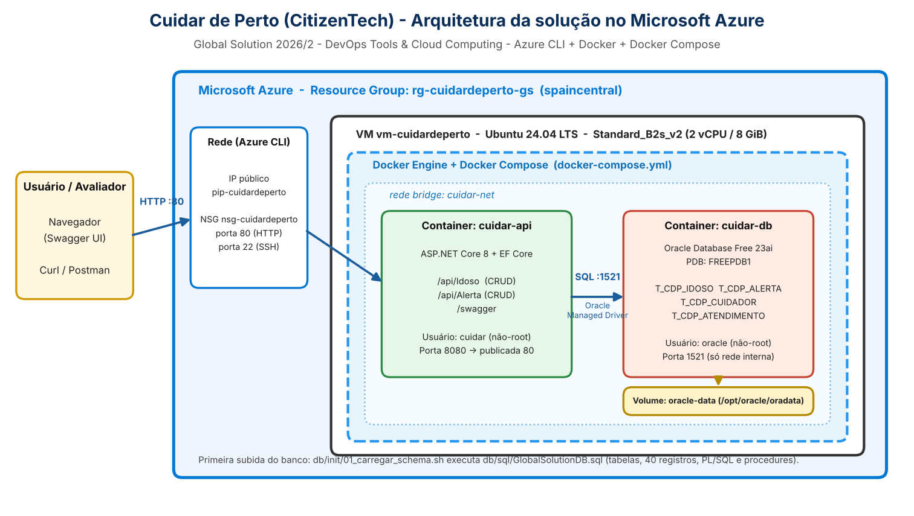

# Cuidar de Perto — Global Solution 2026/2 · DevOps Tools & Cloud Computing

Solução para o acompanhamento de pessoas idosas: cadastro de idosos e registro de alertas de emergência. Nesta entrega a aplicação **.NET 8 (Advanced Business Development with .NET)** e o banco **Oracle (Mastering Relational and Non-Relational Database)** rodam em **dois containers Docker**, orquestrados por **Docker Compose**, dentro de uma **Máquina Virtual no Microsoft Azure provisionada por Azure CLI**.

## Vídeo de demonstração
YouTube (não listado): https://youtu.be/7_62KNTM034

## Integrantes — Turma 2TDSPR
| Nome | RM |
|---|---|
| João Victor de Souza Braz | 566862 |
| Felipe Cuesta Puerta de Oliveira | 567703 |
| Vitor Costa de Godoi | 568448 |
| Vitor Santos Domingues | 568375 |
| Lucas Marcelino Pompeu | 567010 |

## Arquitetura



| Componente | Tecnologia | Detalhes |
|---|---|---|
| Infraestrutura | Azure CLI | Grupo de recursos, VNet, NSG, IP público e VM (`azure/provisionar-vm.sh`) |
| Aplicação | ASP.NET Core 8 + EF Core | Container `cuidar-api`, usuário não-root `cuidar`, `WORKDIR /app`, build multi-stage |
| Banco | Oracle Database Free 23ai | Container `cuidar-db`, PDB `FREEPDB1`, porta `1521` configurada no Compose (o NSG da VM só libera 22 e 80) |
| Persistência | Volume Docker `oracle-data` | Montado em `/opt/oracle/oradata` |
| Orquestração | Docker Compose | Aplicação, banco, rede, volume, portas, variáveis de ambiente e `depends_on` com healthcheck |

**Modelo de dados** (criado por `db/sql/GlobalSolutionDB.sql`, o mesmo script da disciplina de Database): `T_CDP_IDOSO` 1—N `T_CDP_ALERTA`, `T_CDP_IDOSO` 1—N `T_CDP_CUIDADOR`, e `T_CDP_ATENDIMENTO` ligado a alerta e cuidador (10 registros em cada tabela, mais as procedures `ATUALIZAR_STATUS_ATENDIMENTO` e `CONSULTAR_ALERTAS_IDOSO`). As tabelas são criadas **pelo script SQL**; a API não executa migrations.

## Estrutura do repositório
```text
.
├── azure/
│   ├── provisionar-vm.sh        # Azure CLI: grupo de recursos, VM, NSG, IP público, porta 80
│   └── instalar-docker.sh       # roda dentro da VM: instala Docker Engine + Compose
├── db/
│   ├── init/01_carregar_schema.sh   # executa o SQL na 1ª subida do banco
│   └── sql/GlobalSolutionDB.sql     # tabelas, carga, PL/SQL e procedures
├── src/CuidarDePerto.Api/       # código-fonte .NET 8 + Dockerfile
├── docs/arquitetura.png
├── docker-compose.yml
├── .env.example
└── README.md
```

## How To — reproduzindo o ambiente do zero
**Pré-requisitos:** assinatura Azure ativa, Azure CLI (ou Azure Cloud Shell em **Bash**) e Git.

### 1. Provisionar a VM no Azure (Azure CLI)
```bash
az login
git clone https://github.com/PompeuDev/CuidarDePerto-DevOps.git
cd CuidarDePerto-DevOps
bash azure/provisionar-vm.sh        # pede a senha do usuário admlnx da VM
```
O script cria o grupo `rg-cuidardeperto-gs`, a VM `vm-cuidardeperto` (Ubuntu 24.04, `Standard_B2s_v2`), VNet, NSG, IP público, libera a porta **80** e imprime o IP público.
> Se a região/tamanho não estiverem disponíveis na sua assinatura, ajuste `LOCATION` e `VM_SIZE` no topo do script. Use pelo menos 8 GiB de RAM (o Oracle Free consome cerca de 2 GiB).

### 2. Acessar a VM e instalar o Docker
```bash
ssh admlnx@<IP_PUBLICO>
git clone https://github.com/PompeuDev/CuidarDePerto-DevOps.git
cd CuidarDePerto-DevOps
bash azure/instalar-docker.sh
exit                                 # sai e entra de novo para o grupo "docker" valer
ssh admlnx@<IP_PUBLICO>
```

### 3. Configurar as variáveis de ambiente
```bash
cd CuidarDePerto-DevOps
cp .env.example .env
nano .env                            # troque as senhas (evite ; = ' " e espaços)
chmod +x db/init/01_carregar_schema.sh
```

### 4. Subir a solução com Docker Compose
```bash
docker compose up -d --build
docker compose ps                    # aguarde cuidar-db ficar "healthy" (1ª subida: alguns minutos)
docker compose logs -f db            # acompanhe a criação do banco; "DATABASE IS READY TO USE!" = pronto
```
Na primeira subida o Oracle cria o banco e executa `GlobalSolutionDB.sql`. Nas próximas, o volume já tem os dados e o script **não** roda de novo.

### 5. Testar
- Swagger: `http://<IP_PUBLICO>/swagger`
- Listar idosos: `curl http://<IP_PUBLICO>/api/Idoso`

## Evidências técnicas (comandos usados no vídeo)
| Evidência | Comando |
|---|---|
| Containers executando | `docker compose ps` / `docker ps` |
| Logs | `docker compose logs api` e `docker compose logs db` |
| Acesso aos containers | `docker exec -it cuidar-api bash` e `docker exec -it cuidar-db bash` |
| Usuário utilizado | `docker exec cuidar-api id` (cuidar) · `docker exec cuidar-db id` (oracle) |
| Estrutura de diretórios | `docker exec cuidar-api ls -la /app` · `docker exec cuidar-db ls /opt/oracle/oradata` |
| CRUD funcionando | Swagger: `POST`, `GET`, `PUT` e `DELETE` em `/api/Idoso` e `/api/Alerta` |
| SELECT direto no banco | `docker exec -it cuidar-db bash -c 'sqlplus $APP_USER/$APP_USER_PASSWORD@//localhost/FREEPDB1'` e depois `SELECT * FROM T_CDP_IDOSO ORDER BY 1;` |
| Persistência | cadastrar um idoso → `docker compose down` → `docker compose up -d` → o registro continua (`GET /api/Idoso` e `SELECT`) |
| Volume | `docker volume ls` · `docker volume inspect cuidar-de-perto_oracle-data` |
| Rede | `docker network ls` · `docker network inspect cuidar-de-perto_cuidar-net` |
| Configuração do Compose | `docker compose config` · `docker compose top` |

## Endpoints da API
| Recurso | Métodos |
|---|---|
| `/api/Idoso` | `GET` (lista), `GET /{id}`, `POST`, `PUT /{id}`, `DELETE /{id}` |
| `/api/Alerta` | `GET` (lista), `GET /{id}`, `POST`, `PUT /{id}`, `DELETE /{id}` |

Exemplo de corpo para `POST /api/Idoso`:
```json
{ "nome": "Maria da Silva", "idade": 79, "endereco": "Rua das Flores, 10" }
```
Exemplo para `POST /api/Alerta` (use um `idosoId` existente, de 1 a 10 na carga inicial):
```json
{ "tipoAlerta": "Queda", "dataHora": "2026-11-20T10:30:00", "idosoId": 1 }
```

## Segurança
- Senhas fora do repositório: ficam no `.env` (ignorado pelo Git); o repositório traz só o `.env.example`.
- Aplicação e banco rodam com usuários **não-root**.
- A porta 1521 do banco é configurada no Compose, mas o NSG da VM só libera 22 e 80: o banco não fica acessível pela internet e a API o alcança pela rede `cuidar-net`.
- O NSG expõe somente as portas 22 (SSH) e 80 (HTTP).

## Problemas comuns
| Sintoma | Causa provável / solução |
|---|---|
| `api` reinicia e o log mostra `ORA-12514` ou falha de conexão | O banco ainda não terminou de iniciar. Aguarde o `healthy` e confira `docker compose logs db`. |
| Tabelas não existem | O script só roda com o volume vazio. Recrie o volume: `docker compose down -v && docker compose up -d`. **Apaga os dados.** |
| `SP2-0734` / `ORA-00942` ao carregar o SQL | O SQL*Plus não aceita linhas em branco dentro de um comando. O script de init já usa `SET SQLBLANKLINES ON`; ao rodar o SQL manualmente, execute esse comando antes de `@GlobalSolutionDB.sql`. |
| `\r: command not found` no log do banco | O `.sh` foi salvo com CRLF. Rode `sed -i 's/\r$//' db/init/01_carregar_schema.sh` e recrie o volume. |
| `Permission denied` no Docker | Faltou sair e entrar de novo no SSH depois de `instalar-docker.sh`. |
| `http://<IP>/swagger` não abre | Confirme a porta 80 no NSG (`az network nsg rule list -g rg-cuidardeperto-gs --nsg-name nsg-cuidardeperto -o table`) e use `http://`, não `https://`. |
| Erro de memória no Oracle | Use uma VM com 8 GiB de RAM (`Standard_B2s_v2`). |

## Encerrando o ambiente
Depois da apresentação, remova tudo para não gerar custo:
```bash
az group delete --name rg-cuidardeperto-gs --yes --no-wait
```
